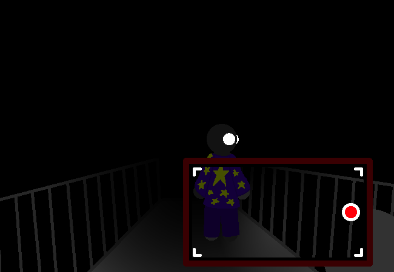

<h1>Continue walking for a bit</h1>

You continue walking down the path for a few minutes without realising how much time has passed.

	
Show new messages

	

		

			<h3>Mei</h3>
			
We've been walking for like 7 minutes now.

			
14/03 - 6:51 am
	
		

		

			<h3>Mike</h3>
			
Oh! Wait really?

			
14/03 - 6:52 am

		

		

			<h3>Mike</h3>
			
I hadn't even noticed, I just kinda zoned out...

			
14/03 - 6:52 am

		

		

			<h3>Mike</h3>
			
But yes, it is far enough now!

			
14/03 - 6:52 am

		

		

			<h3>Mike</h3>
			
Be VERY careful near the edge.

			
14/03 - 6:52 am

		

	

<a href="?p=0209"><h2>> Look down</h2></a>

	<a href="?p=0207">Previous Page</a>
	<h5>26/10</h5>

