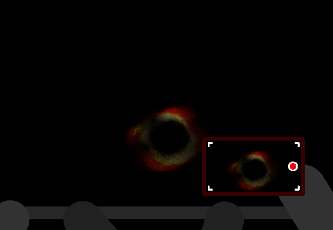

<h1>Look down</h1>

You peer over the railing carefully. Far below you there are some splashes of orange glow.

	
Show new messages

	

		

			<h3>Mike</h3>
			
So... Yes! There!!

			
14/03 - 6:53 am

		

		

			<h3>Mei</h3>
			
What is that??

			
14/03 - 6:53 am
	
		

		

			<h3>Mike</h3>
			
It's the thing we were looking for, I have no idea what actually it is though. The images online always made them look more vibrant.

			
14/03 - 6:53 am

		

		

			<h3>Mei</h3>
			
Could you zoom in on it?

			
14/03 - 6:53 am
	
		

	

<!--<a href="?p=0210"><h2>> ==></h2></a>-->

	<a href="?p=0208">Previous Page</a>
	<h5>26/10</h5>

