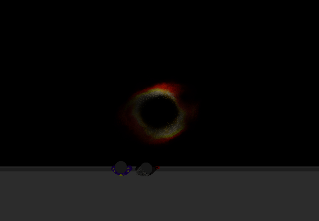

<h1>==></h1>

	
Show new messages

	

		

			<h3>Mike</h3>
			
Hah, it's strangely mesmerising

			
14/03 - 7:01 am

		

		

			<h3>Mei</h3>
			
Yeah it certainly looks cool.

			
14/03 - 7:02 am

		

		

			<h3>Mike</h3>
			
I have no idea why it's getting blocked out sometimes.

			
14/03 - 7:02 am

		

		

			<h3>Mike</h3>
			
I can't remember if that was mentioned online or not...

			
14/03 - 7:02 am

		

	

<a href="?p=0212"><h2>> ==></h2></a>

	<a href="?p=0210">Previous Page</a>
	<h5>27/10</h5>

