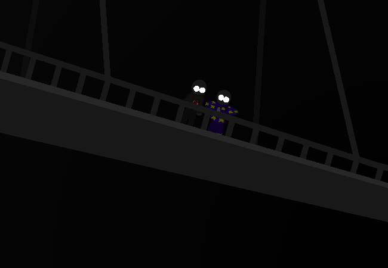

<h1>==></h1>

	
Show new messages

	

		

			<h3>Mei</h3>
			
Ohh! I should probably update the others on what has happened. We can't just keep staring down at whatever <em>that</em> is forever.

			
14/03 - 7:10 am

		

		

			<h3>Mei</h3>
			
...

			
14/03 - 7:10 am

		

		

			<h3>Mei</h3>
			
The connection is really slow down here...

			
14/03 - 7:10 am

		

		

			<h3>Mike</h3>
			
I'm surprised it still works at all to be honest.

			
14/03 - 7:10 am

		

		

			<h3>Mei</h3>
			
Okay... posted!!!

			
14/03 - 7:12 am

		

		

			<h3>Mei</h3>
			
I don't want this eating away at my data so I probably won't send anything else for a while.

			
14/03 - 7:13 am

		

		

			<h3>Mei</h3>
			
...

			
14/03 - 7:13 am

		

		

			<h3>Mike</h3>
			
I wonder where this path leads? Surely it has to go <em>somewhere</em>...?

			
14/03 - 7:14 am

		

		

			<h3>Mei</h3>
			
<em>Shall we go and find out?</em>

			
14/03 - 7:14 am

		

	

<!--<a href="?p=0213"><h2>> ==></h2></a>-->

	<a href="?p=0211">Previous Page</a>
	<h5>27/10</h5>

